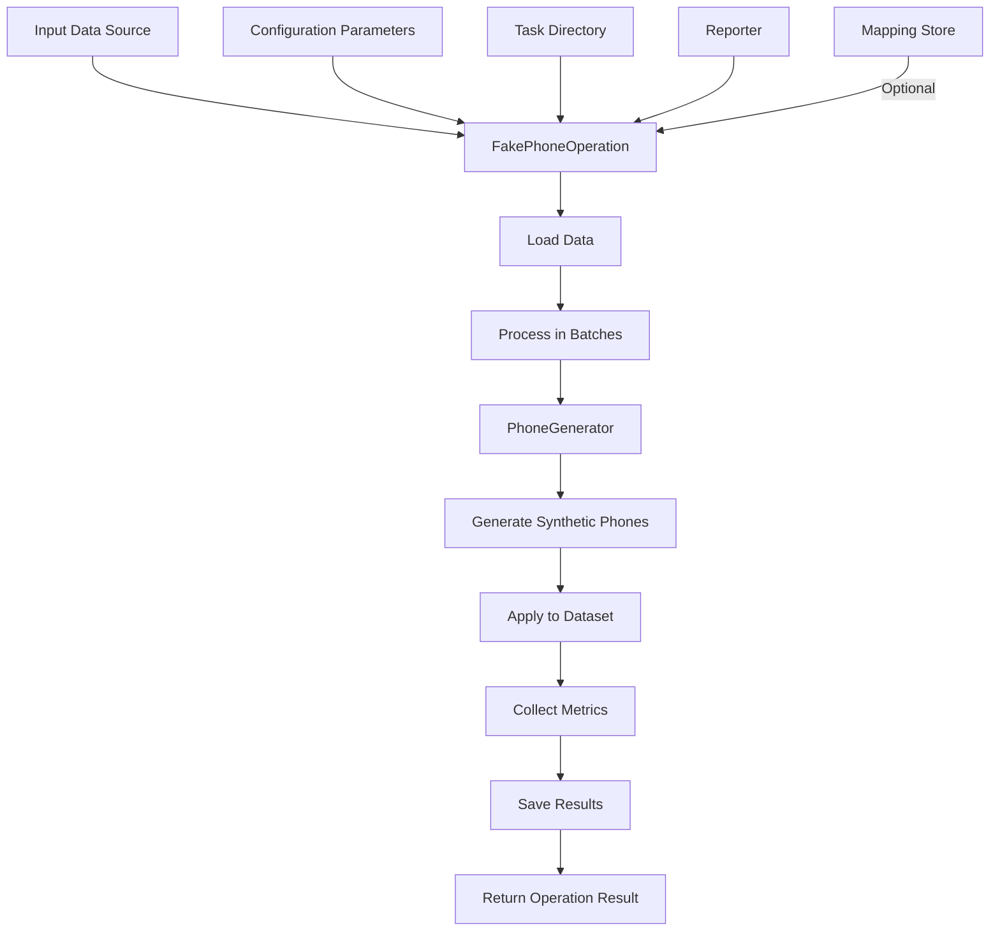

# FakePhoneOperation Module (phone_op.py)

## Overview

The `FakePhoneOperation` module provides a high-level operation for generating synthetic phone numbers in datasets. It processes phone numbers in input data sources, replacing them with synthetic alternatives while preserving country and operator characteristics, collecting metrics, and enabling deterministic generation through PRGN.

## Purpose

This module serves as an integral part of the data anonymization framework, specifically focusing on processing and replacing phone number fields in structured datasets. It bridges the gap between the low-level phone number generation (handled by `PhoneGenerator`) and the data processing workflow, providing a comprehensive operation that can be registered and executed within the operation framework.

## Features

- Integration with the operation registry and workflow
- Batch processing of large datasets
- Country-aware phone generation with configurable country codes
- Configurable operator code preservation
- Format control for output phone numbers
- Comprehensive metrics collection and visualization
- Error handling with retry mechanisms
- Country code preservation options
- Deterministic generation through PRGN with context_salt
- Performance measurement and optimization

## Architecture

### Module Dependencies

```
pamola_core.utils.ops.op_registry
    └── register (Decorator for operation registration)

pamola_core.utils.ops.op_base.BaseOperation
    └── pamola_core.fake_data.base_generator_op.GeneratorOperation
        └── pamola_core.fake_data.operations.phone_op.FakePhoneOperation

pamola_core.fake_data.generators
    └── PhoneGenerator (Generator for phone numbers)

pamola_core.fake_data.commons
    ├── metrics (Metrics collection utilities)
    ├── mapping_store (Consistent mapping storage)
    └── operations (Base operation classes)
    
pamola_core.utils
    ├── io (Input/output utilities)
    └── ops (Operations framework)
```

### Data Flow



## Key Methods

| Method | Description |
|--------|-------------|
| `__init__(field_name, **kwargs)` | Initializes the operation with configuration parameters |
| `execute(data_source, task_dir, reporter, **kwargs)` | Executes the operation on the data source |
| `process_batch(batch)` | Processes a batch of data |
| `process_value(value, **params)` | Processes a single value using the generator |
| `_analyze_country_distribution(df)` | Analyzes distribution of country codes |
| `_analyze_formats(df)` | Analyzes distribution of phone number formats |
| `_collect_specific_metrics(df)` | Collects phone-specific metrics |
| `_calculate_quality_metrics(original_series, generated_series)` | Calculates quality comparison metrics |
| `_determine_format_type(phone)` | Determines the format type of a phone number |
| `_save_metrics(metrics, writer, result, reporter, progress_tracker)` | Saves metrics through the DataWriter (inherited from `GeneratorOperation`) |

## Configuration Parameters

| Parameter | Type | Description | Default |
|-----------|------|-------------|---------|
| `field_name` | str | Field to process (containing phone numbers) | Required |
| `mode` | str | Operation mode (REPLACE or ENRICH) | `"REPLACE"` |
| `output_field_name` | str | Name for the output field (if mode=ENRICH) | `None` |
| `country_codes` | List/Dict | Country codes to use | `None` |
| `operator_codes_dict` | str | Path to dictionary of operator codes | `None` |
| `format` | str | Format for phone number generation | `None` |
| `validate_source` | bool | Whether to validate source phone numbers | `True` |
| `handle_invalid_phone` | str | How to handle invalid numbers | `"generate_new"` |
| `default_country` | str | Default country for generation | `"us"` |
| `preserve_country_code` | bool | Whether to preserve country code from original | `True` |
| `preserve_operator_code` | bool | Whether to preserve operator code from original | `False` |
| `region` | str | Region/country for formatting | `None` |
| `chunk_size` | int | Number of records to process in one chunk | `10000` |
| `null_strategy` | str | Strategy for handling NULL values | `"PRESERVE"` |
| `consistency_mechanism` | str | Method for ensuring consistency | `"prgn"` |
| `mapping_store_path` | str | Path to store mappings | `None` |
| `id_field` | str | Field for record identification | `None` |
| `key` | str | Key for encryption/PRGN | `None` |
| `context_salt` | str | Salt for PRGN | `None` |
| `save_mapping` | bool | Whether to save mapping to file (written encrypted; requires `use_encryption=True` and `encryption_key`) | `False` |
| `column_prefix` | str | Prefix for new column (if mode=ENRICH) | `"_"` |
| `country_code_field` | str | Field containing country codes | `None` |
| `detailed_metrics` | bool | Whether to collect detailed metrics | `False` |
| `max_retries` | int | Maximum number of retries for generation on error | `3` |

## Operation Results

`execute()` returns an `OperationResult`:

| Field | Description |
|-------|-------------|
| `status` | `OperationStatus` (`SUCCESS`, `ERROR`, ...) |
| `error_message` | Error description (if any) |
| `metrics` | Collected metrics from operation |
| `artifacts` | List of `OperationArtifact` objects (output data, metrics, visualizations, mapping) |
| `execution_time` | Time taken to execute the operation |

The processed data is written to `{task_dir}/output/` (when `save_output=True`).

## Metrics Collected

| Metric Category | Metrics | Description |
|----------------|---------|-------------|
| `phone_generator` | Format, default country, region, etc. | Generator configuration details |
| `performance` | Generation time, records per second, error count | Performance statistics |
| `country_distribution` | Total phones, unique codes, distribution | Country code statistics |
| `format_distribution` | Format type frequencies | Phone format statistics |
| `quality_metrics` | Length similarity, country code preservation | Quality comparison |

## Usage Examples

```python
from pathlib import Path
from unittest.mock import MagicMock
from pamola_core import FakePhoneOperation
from pamola_core.utils.ops.op_data_source import DataSource

# Use a TaskReporter in a real task; a mock is enough for a quick run
reporter = MagicMock()

# Create the operation
phone_op = FakePhoneOperation(
    field_name="contact_phone",
    mode="ENRICH",
    output_field_name="synthetic_phone",
    country_codes={"1": 0.6, "44": 0.2, "7": 0.2},
    format="+CC (AAA) XXX-XXXX",
    preserve_country_code=True,
    chunk_size=5000,
    consistency_mechanism="mapping",
    mapping_store_path="./mappings/phone_mappings.json",
    save_mapping=True,              # mapping is written encrypted:
    use_encryption=True,            # requires use_encryption
    encryption_key="<task key>",    # and the task encryption key
    detailed_metrics=True
)

# Execute on a file
result = phone_op.execute(
    data_source=DataSource.from_file_path("path/to/contacts.csv"),
    task_dir=Path("./task_dir"),
    reporter=reporter,
)

# Access results
if result.status.name == "SUCCESS":
    print(f"Finished in {result.execution_time} seconds")
    for artifact in result.artifacts:
        print(f"{artifact.artifact_type}: {artifact.path}")
else:
    print(f"Operation failed: {result.error_message}")
```

## Artifacts Generated

| Artifact Type | Path Pattern | Description |
|--------------|--------------|-------------|
| Processed Data | `{task_dir}/output/{field_name}_FakePhoneOperation_output_{timestamp}.csv` | Output dataset (when `save_output=True`) |
| Metrics | `{task_dir}/metrics/{field_name}_FakePhoneOperation_metrics_{timestamp}.json` | Operation metrics in JSON format |
| Visualizations | `{task_dir}/visualizations/FakePhoneOperation_{field_name}_value_distribution_{timestamp}.png` | Value distribution (when `generate_visualization=True`) |
| Mapping | `{task_dir}/maps/{name}_{field_name}_mapping.json` | Encrypted mapping of original to synthetic values (when `save_mapping=True`) |

## Limitations

- The operation requires pandas DataFrame for batch processing
- Complex operations on very large datasets may require significant memory
- Visualization generation requires matplotlib to be installed
- Mapping store requires serializable data for storage
- Quality metrics are heuristics and may not fully represent semantic equivalence
- Country code detection is pattern-based and may not work for all international formats
- The maximum number of retries is fixed and may not be sufficient for all error scenarios
- Parallelization is not directly supported within a single operation instance